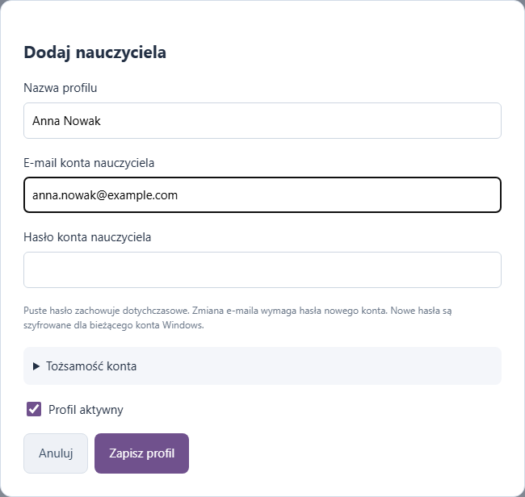
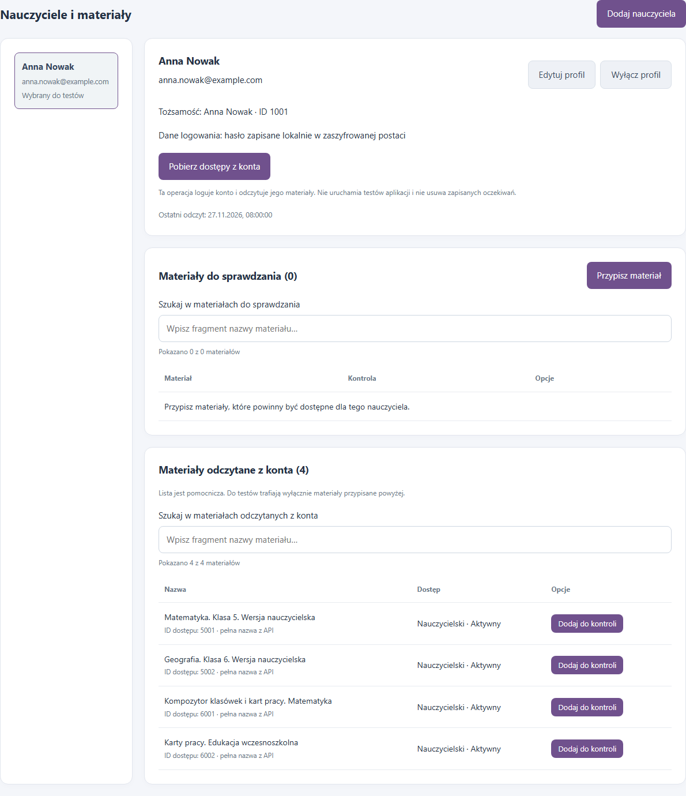
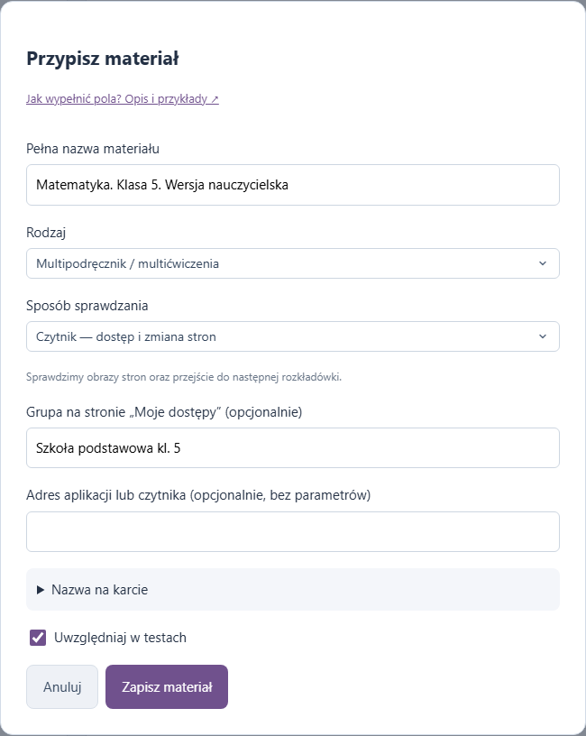
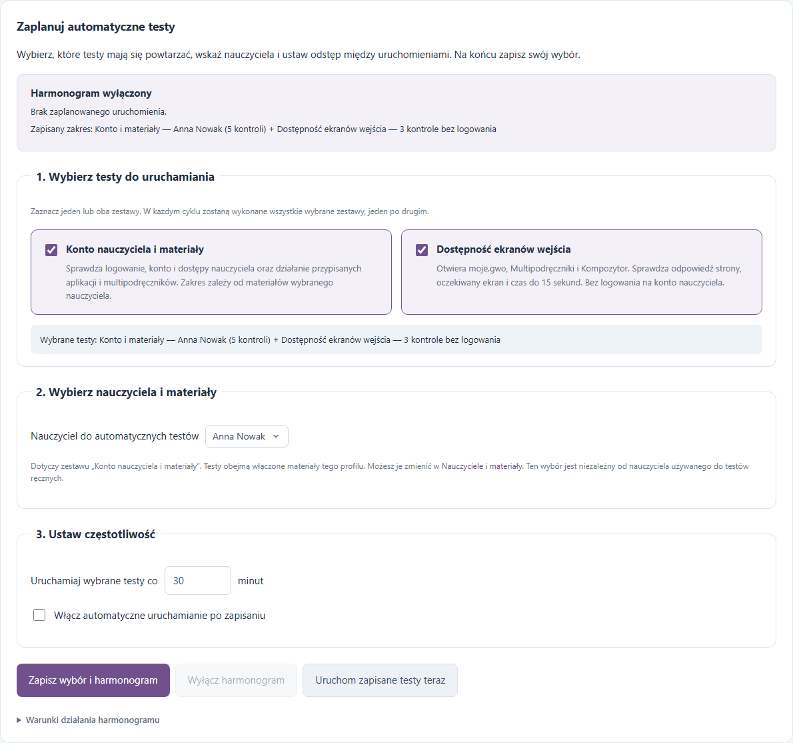
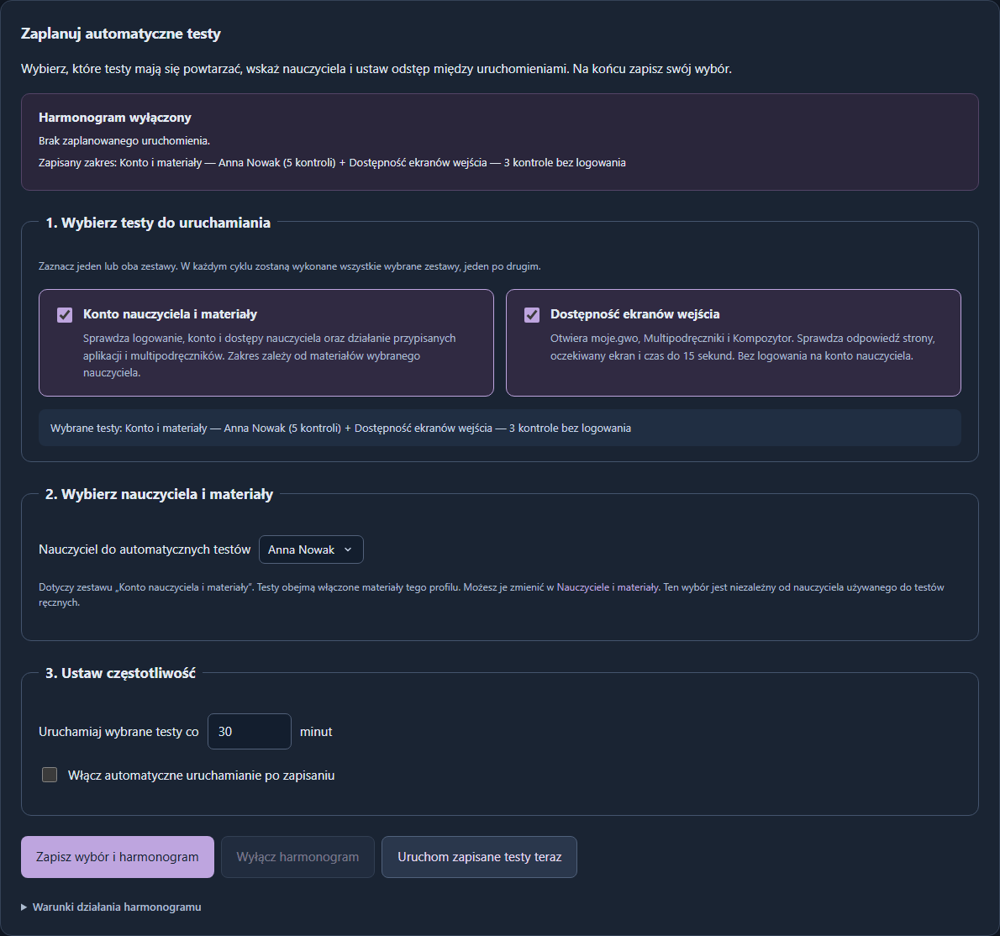
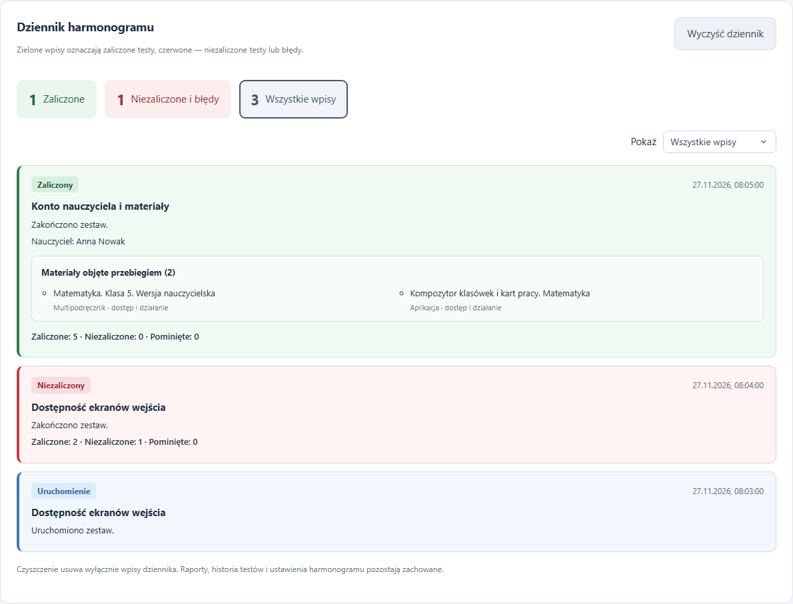

# Moje GWO — testy TEST i PROD

Wspólny panel do sprawdzania kont nauczycieli, materiałów i usług GWO. Środowisko TEST lub PROD wybierasz w panelu albo w poleceniu.

**Instrukcja krok po kroku ze zrzutami:** [Konfiguracja i uruchamianie testów](docs/INSTRUKCJA_KONFIGURACJI.md).

**Pola formularza materiału:** [co wpisać, skąd wziąć dane i gotowe przykłady](docs/INSTRUKCJA_KONFIGURACJI.md#jak-wypełnić-pola-materiału). Ta sama pomoc jest dostępna w panelu przez **Jak wypełnić pola?**.

## Instalacja

Wymagane: **Git, Node.js 22+ i npm**. Polecenia dla PowerShell:

```powershell
git clone https://github.com/nikpan123/mojeGWO.git
cd mojeGWO
npm.cmd ci
npx.cmd playwright install chromium
Copy-Item .env.test.example .env.test
Copy-Item .env.prod.example .env.prod
Copy-Item config/test.example.json config/test.local.json
Copy-Item config/prod.example.json config/prod.local.json
```

Uzupełnij dane kont w `.env.test` i `.env.prod`, a ustawienia środowisk w `config/*.local.json`. PROD wymaga `runEnabled: true` i poprawnego `authMode`. Przy aktualizacji istniejącej instalacji zachowaj własne pliki ustawień.

```powershell
npm.cmd run panel
```

Otwórz adres wyświetlony w terminalu. Panel próbuje portu **4182**, następnie **4184**, a w razie konfliktu wybiera inny wolny port. W panelu dodawaj nauczycieli, pobieraj ich dostępy i wybieraj materiały do testów.

W prawym górnym rogu wybierz **Motyw: Jasny / Ciemny / Systemowy**. Panel zapamiętuje wybór i korzysta z tego samego ustawienia co lokalne Centrum testów.

## Technologie i zakres testów

- **Node.js / JavaScript (ES Modules)** — lokalny serwer HTTP, panel i obsługa środowisk.
- **Playwright / Chromium** — sprawdzanie konta i roli nauczyciela, aktywnych dostępów, otwierania materiałów, zmiany stron czytnika oraz skonfigurowanych funkcji aplikacji. Dostępne są logi, podgląd i raporty.
- **Healthchecki usług** — HTTPS, odpowiedź JSON, czas i nagłówki cache. Adresy wymagają konfiguracji osobno dla TEST i PROD.
- **PROD** — dodatkowe anonimowe testy dostępności trzech stron.
- **k6, opcjonalnie** — ręczne testy obciążeniowe wyłącznie na TEST; silnik umieść w `tools/k6.exe`.
- **Windows DPAPI** — szyfrowanie haseł zapisanych w profilach. Pliki kont, sesji i wyników pozostają lokalne i są wykluczone z Git.

## Nauczyciele i materiały

1. Wybierz **TEST lub PROD → Nauczyciele i materiały → Dodaj nauczyciela**. Podaj nazwę profilu, e-mail i hasło. W TEST uzupełnij również własne logowanie GitLaba albo użyj wspólnego z `.env.test`.
2. Zapisz profil i kliknij **Pobierz dostępy z konta**. Panel potwierdzi tożsamość i pokaże dostępne aplikacje oraz multipodręczniki. Nie loguj się równolegle na to samo konto.
3. Przy wybranym materiale kliknij **Dodaj do kontroli**, wybierz sposób sprawdzania i zapisz. Multipodręcznik może być sprawdzany ze zmianą stron; aplikacja — jako sam dostęp, Kompozytor ze wskazaną klasą, katalog kart pracy lub dopasowany wzorzec. Samo pobranie listy nie przypisuje materiałów do testów.
4. Użyj **Wybierz do testów** przy profilu albo listy **Nauczyciel** w widoku uruchamiania. Testy obejmą jego przypisane, włączone materiały. W harmonogramie nauczyciela wybiera się osobno.

Pole **Wzorzec aplikacji** pojawia się tylko po wybraniu **Pełny test według istniejącego wzorca**. Pozostałe sposoby sprawdzania nie wymagają jego wyboru.

Nad listami materiałów są wyszukiwarki po nazwie. Wyniki zawężają się podczas pisania, osobno dla materiałów do sprawdzania i dostępów odczytanych z konta.

<details>
<summary>Zrzuty ekranu — przykładowe dane nauczyciela</summary>

**Dodawanie nauczyciela**



**Lista dostępów: przy aplikacji lub multipodręczniku wybierz „Dodaj do kontroli”**



**Wybór sposobu sprawdzania materiału**



</details>

## Testy ręczne

W panelu wybierz **TEST/PROD → Uruchom testy**, a następnie zestaw i nauczyciela. Z terminalu:

```powershell
npm.cmd test -- --env test
npm.cmd test -- --env prod
npm.cmd run test:services -- --env prod
npm.cmd run test:pages -- --env prod
npm.cmd run test:list -- --env test  # sama lista, bez uruchamiania
npm.cmd run check:local             # lokalne kontrole kodu i panelu
```

Bez parametru środowiska wybierany jest TEST. Przed testami przeglądarkowymi sesja jest sprawdzana i w razie potrzeby odnawiana z lokalnych danych konta.

## Co sprawdza „Konto nauczyciela i materiały”

Zestaw działa w przeglądarce Playwright dla wybranego nauczyciela i jego włączonych materiałów. Przed startem sprawdza zapisaną sesję, a w razie potrzeby ponawia logowanie z lokalnych danych.

| Kontrola | Sposób sprawdzania |
| --- | --- |
| **HC-01 — konto i panel** | Otwiera katalog materiałów. Sprawdza poprawną odpowiedź strony i API konta, zgodność identyfikatora oraz nazwy nauczyciela, wymaganą rolę i nazwę widoczną w panelu. |
| **HC-02 — dostęp do materiału** | Pobiera listę dostępów z API, rozpoznaje materiał po pełnej nazwie i zapisanym identyfikatorze dostępu, jeśli jest przypisany. Wybiera właściwą zakładkę i grupę, odnajduje jednoznaczny kafelek oraz potwierdza aktywny, niewygasły dostęp nauczycielski. |
| **HC-03 — działanie materiału** | Klika uruchomienie na kafelku i czeka na nową kartę HTTPS. Jeśli skonfigurowano adres aplikacji, sprawdza jej domenę i ścieżkę. Weryfikuje gotowość interfejsu oraz brak komunikatów o zakończonym dostępie i braku autoryzacji. Następnie wykonuje czynność opisaną poniżej. |

**Po otwarciu multipodręcznika — wariant „Czytnik — dostęp i zmiana stron”:**

1. Czeka na widoczne obrazy stron i potwierdza ich załadowanie: obraz musi mieć zakończone ładowanie oraz niezerową szerokość.
2. Jeśli tak ustawiono materiał i czytnik pokazuje jeszcze okładkę, przechodzi najpierw do pierwszej rozkładówki.
3. Zapamiętuje oznaczenie aktualnych stron i źródła ich obrazów, po czym klika **następną stronę**.
4. Wymaga zmiany oznaczenia stron **i** źródeł obrazów oraz poprawnego załadowania nowych obrazów. W raporcie zapisuje numery przed i po przejściu oraz informację o załadowanej treści. Sprawdza jedno przejście, nie wszystkie strony podręcznika.

Czytnik zapisuje dwa zrzuty do raportu i ręcznej galerii: **1. Po otwarciu multipodręcznika** oraz **2. Po zmianie rozkładówki**. Drugi powstaje dopiero po potwierdzeniu zmiany stron i załadowaniu ich obrazów.

**Po otwarciu Kompozytora — wariant „Kompozytor — dostęp i lista zestawów”:**

1. Odnajduje bibliotekę lub klasę wskazaną w konfiguracji materiału. Przy kilku dostępach do tego samego katalogu wybiera jednoznaczny aktywny dostęp z najpóźniejszym terminem ważności; niejednoznaczność kończy się błędem.
2. Sprawdza widoczność właściwej karty i brak komunikatu **Dostęp zakończony** dla wybranego dostępu.
3. Klika kartę klasy lub biblioteki i wymaga poprawnego pobrania listy **Twoje zestawy**: HTTP 200, JSON z listą i odpowiedź dla wybranej biblioteki.
4. Otwiera **Twoje zestawy**, czeka na zakończenie ładowania i porównuje liczbę oraz nazwy pozycji z odpowiedzią serwera. Pusta lista przechodzi tylko przy odpowiedzi `[]` i komunikacie o braku zestawów. Błąd pobierania, niepoprawne dane lub sam widoczny nagłówek nie wystarczają. Nie tworzy, nie edytuje, nie drukuje ani nie usuwa zestawów; nie otwiera treści wszystkich zestawów.

Każdy test działania Kompozytora zapisuje dwa zrzuty: **1. Po otwarciu aplikacji** i **2. Po sprawdzeniu funkcji**. Dla matematyki i fizyki drugi obraz pokazuje ekran po wejściu do klasy z zakładką **Twoje zestawy**, a dla edukacji wczesnoszkolnej — załadowany katalog zadań. Ten sam układ obowiązuje w raporcie i ręcznej galerii panelu; wcześniejsze przebiegi zachowują dotychczasowe obrazy.

Regulamin może zostać zaakceptowany automatycznie tylko przy zapisanej zgodzie dla rozpoznanej aplikacji. Dla trybu **Tylko obecność i ważność dostępu** wykonywane jest HC-02, bez otwierania materiału i HC-03. Inne warianty wykonują skonfigurowaną czynność i sprawdzają jej oczekiwany rezultat. Zestaw zawiera **jedną kontrolę konta + kontrolę dostępu do każdego materiału + kontrolę działania każdego materiału z włączonym takim zakresem**. Raport pokazuje wyniki poszczególnych kontroli, zrzuty i załączniki diagnostyczne.

## Harmonogram

W panelu **PROD → Harmonogram**:

1. Zaznacz testy: **Konto nauczyciela i materiały**, **Dostępność ekranów wejścia** albo oba zestawy. Opisy przy wyborze wyjaśniają ich zakres.
2. Dla testów konta wybierz nauczyciela. Panel pokaże jego zakres i liczbę kontroli. Same testy dostępności stron nie wymagają konta.
3. Ustaw odstęp, zaznacz automatyczne uruchamianie i kliknij **Zapisz wybór i harmonogram**. Podsumowanie rozróżnia zapisany zakres i zmiany oczekujące na zapis.

Komputer i panel muszą działać; samą kartę przeglądarki można zamknąć. Wybrane zestawy wykonują się kolejno, a zajęty termin jest pomijany. Harmonogram można wyłączyć w tym samym widoku. Testy obciążeniowe nie są uruchamiane z harmonogramu.

Dziennik oznacza zaliczone testy na zielono, a niezaliczone i błędy na czerwono. Można filtrować wyniki oraz użyć **Wyczyść dziennik** — raporty, historia testów i ustawienia pozostają zachowane.

Przy wyniku zestawu konta widoczna jest nazwa nauczyciela i lista materiałów objętych przebiegiem wraz z zakresem kontroli. Lista pochodzi z zapisanej konfiguracji tego uruchomienia; późniejsza edycja profilu jej nie zmienia. Szczegółowe wyniki kontroli są w raporcie.

<details>
<summary>Przykładowy dziennik harmonogramu</summary>







</details>

Historia i raporty są dostępne w panelu, osobno dla TEST i PROD.

## Powiadomienia Mattermost

Panel PROD może wysyłać powiadomienia po **niezaliczonych przebiegach**, uruchamianych ręcznie z panelu lub przez harmonogram. Wiadomość zawiera nazwę zestawu, liczbę zaliczonych i niezaliczonych kontroli oraz link do lokalnego raportu.

1. W Mattermost utwórz **Incoming Webhook** dla wybranego kanału.
2. W lokalnym pliku `.env.prod` ustaw `MOJE_GWO_MATTERMOST_WEBHOOK_URL='adres_webhooka'`. Nie dodawaj tego pliku do Git.
3. W panelu **PROD → Powiadomienia** opcjonalnie wpisz swój login, np. `@imie.nazwisko`, zaznacz powiadamianie i zapisz ustawienia.
4. Przyciskiem **Wyślij wiadomość kontrolną** sprawdź połączenie. W tym widoku można też wyłączyć powiadomienia i sprawdzić wynik ostatniej wysyłki.

Powiadomienia są domyślnie wyłączone. Link do raportu działa tylko na komputerze uruchamiającym panel. Hasła i sesje nie są wysyłane w wiadomościach.
