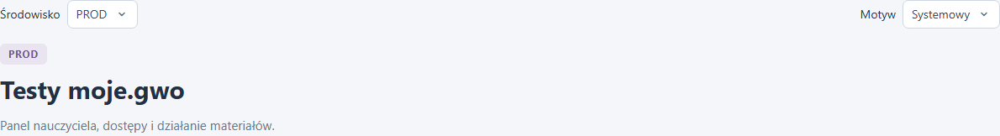
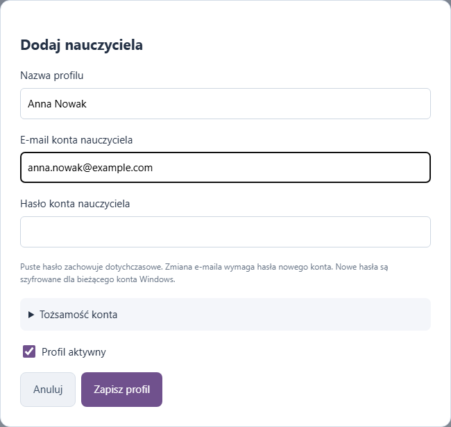
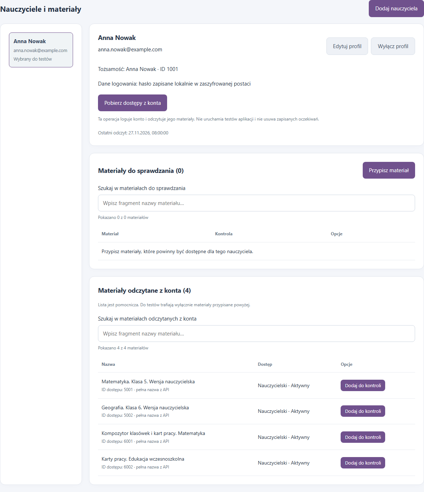
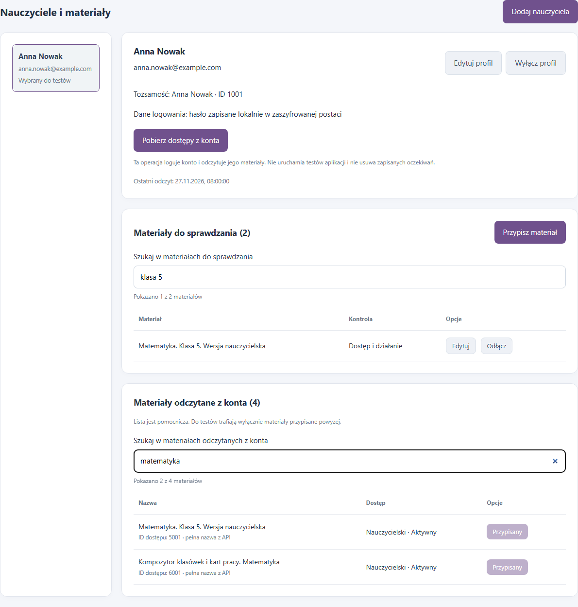
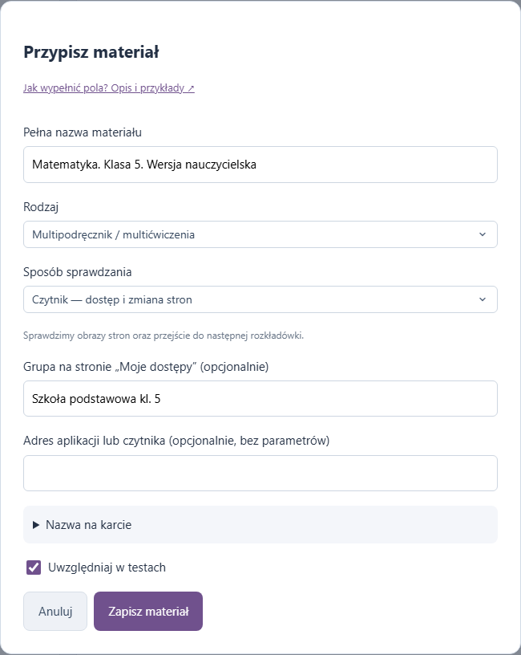
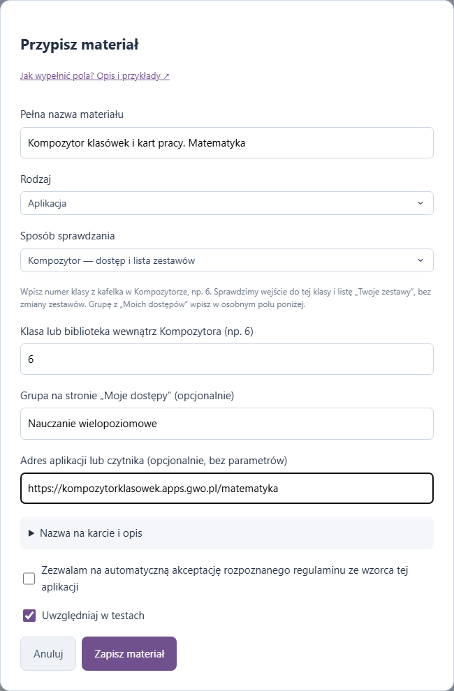
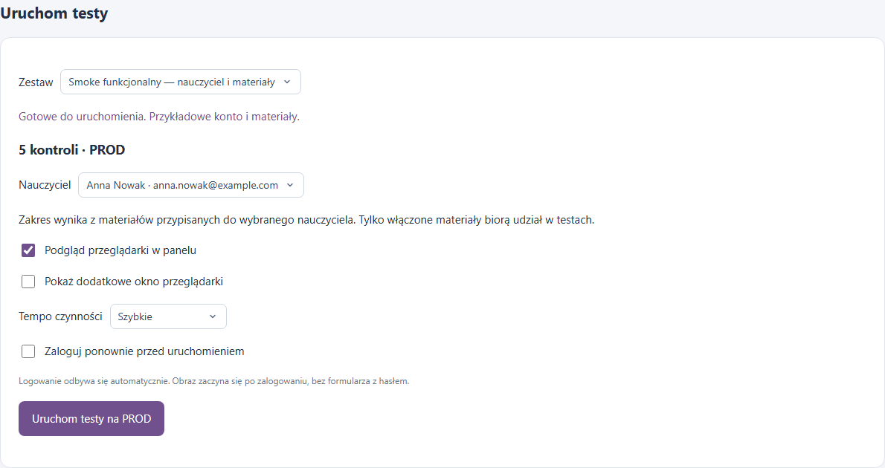
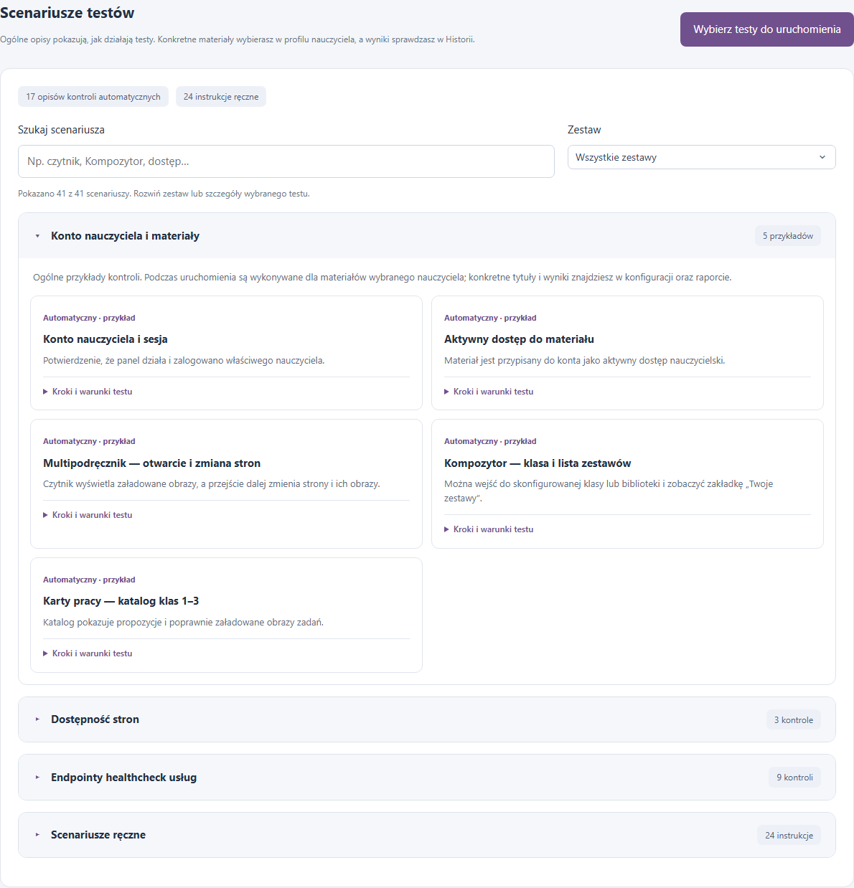
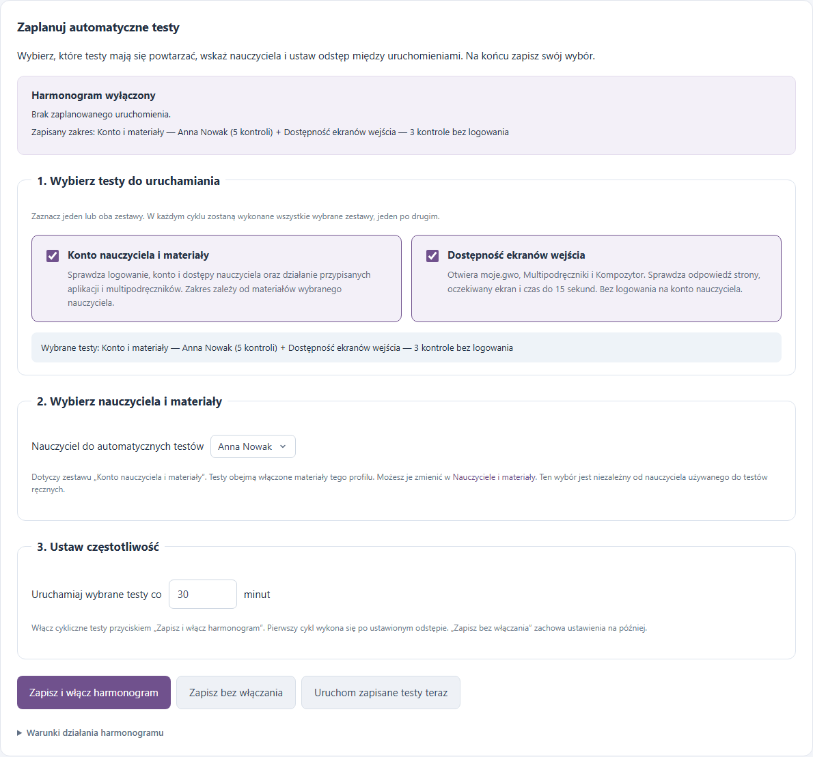
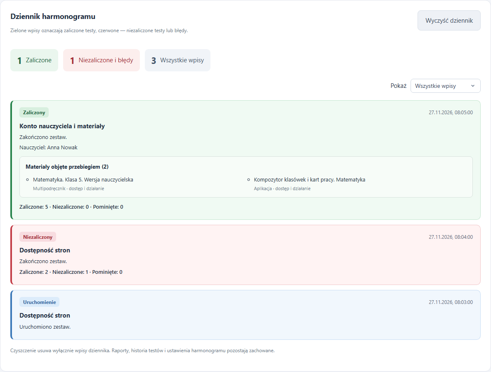

# Konfiguracja i uruchamianie testów Moje GWO

Instrukcja prowadzi od pobrania projektu do pierwszego testu oraz harmonogramu. Dotyczy Windows i PowerShell. Zrzuty pokazują **fikcyjne konto i przykładowe materiały**; wpisz własne dane i wybierz dostępy rzeczywiście przydzielone Twojemu nauczycielowi.

## Spis treści

1. [Przygotowanie komputera](#1-przygotowanie-komputera)
2. [Pliki lokalne i dane logowania](#2-pliki-lokalne-i-dane-logowania)
3. [Konfiguracja środowiska TEST lub PROD](#3-konfiguracja-środowiska-test-lub-prod)
4. [Uruchomienie panelu](#4-uruchomienie-panelu)
5. [Nauczyciel i odczyt jego dostępów](#5-nauczyciel-i-odczyt-jego-dostępów)
6. [Wybór aplikacji i multipodręczników](#6-wybór-aplikacji-i-multipodręczników)
   - [Pola materiału: co wpisać, skąd wziąć dane i przykłady](#jak-wypełnić-pola-materiału)
7. [Pierwsze uruchomienie i wyniki](#7-pierwsze-uruchomienie-i-wyniki)
8. [Harmonogram](#8-harmonogram)
9. [Pozostałe zestawy i Mattermost](#9-pozostałe-zestawy-i-mattermost)
10. [Najczęstsze problemy](#10-najczęstsze-problemy)

## 1. Przygotowanie komputera

Potrzebujesz **Git**, **Node.js 22 lub nowszego z npm**, dostępu do wybranego środowiska GWO i konta nauczyciela z materiałami. Jeżeli środowisko wymaga sieci firmowej lub VPN, połącz się przed logowaniem.

Sprawdź dostępność narzędzi w PowerShell:

```powershell
git --version
node --version
npm.cmd --version
```

### Nowa instalacja

```powershell
git clone https://github.com/nikpan123/mojeGWO.git
cd mojeGWO
npm.cmd ci
npx.cmd playwright install chromium
```

`npm.cmd ci` instaluje zależności projektu. Ostatnie polecenie pobiera przeglądarkę Chromium dla Playwright.

### Projekt jest już na tym komputerze

Otwórz PowerShell w istniejącym folderze projektu. Na komputerze, na którym przygotowano połączony projekt, jest to:

```powershell
cd C:\Users\npanek\Documents\ChatGPT\MojeGwoTesty
```

Jeżeli konta i materiały zostały już przeniesione i panel zgłasza gotowość, przejdź do [uruchamiania](#7-pierwsze-uruchomienie-i-wyniki). Nie zastępuj istniejących plików lokalnych pustymi wzorcami.

## 2. Pliki lokalne i dane logowania

TEST i PROD korzystają ze wspólnego kodu, ale mają osobne dane.

| Plik lub folder | Zastosowanie |
| --- | --- |
| `.env.test` | Logowanie TEST, w tym wspólne konto GitLaba. |
| `.env.prod` | Logowanie PROD i opcjonalny webhook Mattermost. |
| `config/test.local.json` | Adresy i ustawienia środowiska TEST. |
| `config/prod.local.json` | Adresy, sposób logowania i włączenie PROD. |
| `.health/test/`, `.health/prod/` | Profile, zaszyfrowane hasła profili, historia, harmonogram i raporty. |
| `playwright/.auth/test/`, `playwright/.auth/prod/` | Zapisane sesje przeglądarki. |

Poniższy fragment utworzy **tylko brakujące pliki**:

```powershell
$configFiles = @{
  '.env.test.example' = '.env.test'
  '.env.prod.example' = '.env.prod'
  'config/test.example.json' = 'config/test.local.json'
  'config/prod.example.json' = 'config/prod.local.json'
}
foreach ($sourceFile in $configFiles.Keys) {
  $targetFile = $configFiles[$sourceFile]
  if (-not (Test-Path -LiteralPath $targetFile)) {
    Copy-Item -LiteralPath $sourceFile -Destination $targetFile
  }
}
```

Otwórz pliki `.env` w edytorze. Wpisuj wartości między apostrofami, zgodnie ze wzorcami w repozytorium.

| Środowisko | Zmienne nauczyciela | Zmienne GitLaba |
| --- | --- | --- |
| TEST | `MOJE_GWO_TEST_USERNAME`, `MOJE_GWO_TEST_PASSWORD` | `GITLAB_TEST_USERNAME`, `GITLAB_TEST_PASSWORD` |
| PROD | `MOJE_GWO_PROD_USERNAME`, `MOJE_GWO_PROD_PASSWORD` | Nie dotyczy — GitLab jest używany tylko w TEST. |

**Dwa sposoby przechowywania konta nauczyciela:** dotychczasowy profil może korzystać z `.env`; nowe profile dodane w panelu zapisują własne hasło w lokalnym magazynie Windows DPAPI. Dla nowego profilu TEST można użyć wspólnych danych GitLaba z `.env.test`, ale hasło portalu nauczyciela podaje się w jego profilu. GitLab i portal nauczyciela mogą mieć różne hasła.

Zmienne ustawione w procesie mają pierwszeństwo przed plikiem `.env`. Nie używaj kont, haseł ani sesji TEST jako danych PROD. Pliki lokalne i sesje są ignorowane przez Git. Hasła profili zaszyfrowane przez Windows są związane z kontem Windows; na innym komputerze najprościej ponownie dodać konta i zalogować je w panelu.

## 3. Konfiguracja środowiska TEST lub PROD

### TEST

W pliku `config/test.local.json` pozostaw ustawienia techniczne ze wzorca. Zmień `accountEmail` na e-mail swojego nauczyciela. Przy nowej konfiguracji możesz ustawić `resources` na pustą tablicę i przypisać własne materiały później w panelu, zamiast używać materiałów przykładowych.

Kompletny przykład początkowy dla logowania przez GitLab i portal:

```json
{
  "environment": "test",
  "workflow": "portal-v1",
  "authMode": "gitlab-and-portal",
  "baseURL": "https://moje.gwotest.pl",
  "accountEmail": "nauczyciel@example.com",
  "accountDisplayName": "",
  "accountUserId": null,
  "requiredUserFunction": "teacher_verified",
  "identityAPI": "/api/v3/user_info",
  "authenticatedUserSelector": ".main-toolbar__desktop .main-toolbar__user-name",
  "catalogPath": "/accesses",
  "sessionFile": "playwright/.auth/test/teacher.json",
  "allowedHosts": [
    "moje.gwotest.pl",
    "gitlab.gwo.pl",
    "auth.gwotest.pl",
    "zgody.gwotest.pl",
    "files.gwotest.pl",
    "fonts.gstatic.com",
    "fonts.googleapis.com",
    "kompozytorklasowek.apps.gwotest.pl",
    "old-ksiegarnia.gwotest.pl",
    "launcher-multipodreczniki.apps.gwotest.pl",
    "multipodreczniki.apps.gwotest.pl"
  ],
  "resources": []
}
```

Zastąp przykładowy e-mail własnym. Nazwę i identyfikator konta potwierdzi odczyt dostępów; nie trzeba ich zgadywać.

### PROD

Wzorzec PROD ma pustą konfigurację i `runEnabled: false`. W `config/prod.local.json` uzupełnij adres portalu, dozwolone hosty, rolę i element rozpoznający konto. Poniższy przykład pokazuje konfigurację portalu używaną przez projekt, przed przypisaniem własnych materiałów:

```json
{
  "environment": "prod",
  "runEnabled": false,
  "workflow": "portal-v1",
  "authMode": "portal",
  "baseURL": "https://moje.gwo.pl",
  "accountEmail": "nauczyciel@example.com",
  "accountDisplayName": "",
  "accountUserId": null,
  "requiredUserFunction": "teacher_verified",
  "identityAPI": "/api/v3/user_info",
  "authenticatedUserSelector": ".main-toolbar__desktop .main-toolbar__user-name",
  "catalogPath": "/accesses",
  "sessionFile": "playwright/.auth/prod/teacher.json",
  "allowedHosts": [
    "moje.gwo.pl",
    "kompozytorklasowek.apps.gwo.pl",
    "multipodreczniki.apps.gwo.pl",
    "old-ksiegarnia.gwo.pl",
    "launcher-multipodreczniki.apps.gwo.pl"
  ],
  "resources": []
}
```

Zastąp e-mail własnym. Gdy konfiguracja adresów jest gotowa i chcesz umożliwić pracę na PROD, ustaw **`runEnabled: true`**. To ustawienie jest potrzebne także do zalogowania nauczyciela i pobrania jego dostępów. Samo przełączenie panelu na PROD nie włącza środowiska.

Dla PROD używaj `authMode: "portal"` — logowania kontem portalu bez GitLaba. Sposób `gitlab-and-portal` i dane GitLaba dotyczą wyłącznie TEST. Lista hostów ogranicza ruch przeglądarki. Dodatkowe hosty aplikacji z tego samego środowiska mogą być dopuszczane przy przypisaniu ich właściwego adresu w profilu materiału.

**Po zmianie pliku środowiska:** odśwież panel. Zmiany kont i materiałów zapisanych już w profilach wykonuj przez panel — edycja samego pliku bazowego nie zastępuje istniejącego profilu.

## 4. Uruchomienie panelu

W folderze projektu uruchom:

```powershell
npm.cmd run panel
```

Otwórz adres podany w terminalu. Zwykle będzie to `http://127.0.0.1:4182`; przy zajętym porcie panel spróbuje `4184`, a następnie innego wolnego portu. Nie musisz zamykać innych aplikacji.

Na przygotowanym komputerze skrót **Centrum-testow** uruchamia Centrum oraz wspólny panel moje.gwo na `http://127.0.0.1:4184`. Możesz korzystać z panelu przez Centrum albo w osobnej karcie. Skrót Centrum jest lokalną integracją; samo sklonowanie repozytorium na innym komputerze nie tworzy tego skrótu.

W nagłówku kliknij **TEST** albo **PROD**. Aktywne środowisko jest wyróżnione. Konta i materiały skonfiguruj osobno dla każdego środowiska. Przyciskami **Jasny / Ciemny / Systemowy** w prawym górnym rogu zmienisz motyw; panel zapamiętuje wybór.

Zegar u góry pokazuje czas polski. Pod nim widnieje następny termin, jeśli harmonogram jest włączony. Podczas przebiegu pojawia się **Testy w toku** oraz godzina jego rozpoczęcia (czas polski), a tytuł karty przeglądarki informuje o trwających testach. Po zakończeniu godzina rozpoczęcia znika i wraca zwykły tytuł karty. Kliknięcie statusu otwiera przebieg i logi. **Zatrzymaj harmonogram** wyłącza cały harmonogram, przyszłe terminy oraz pozostałe zestawy cyklu, a także kończy bieżący przebieg wraz z jego procesami przeglądarki. Gdy harmonogram jest nieaktywny lub jesteś na TEST, podczas ręcznego przebiegu przycisk ma nazwę **Zatrzymaj test**. W historii ma on wynik **Zatrzymany**, a nie **Niezaliczony**. Aby wznowić automatyczne testy, włącz harmonogram ponownie i zapisz ustawienia. Przerwany przebieg może nie mieć kompletnego raportu HTML.



Przy uruchomieniu z PowerShell pozostaw proces panelu działający. Zakończysz go przez **Ctrl+C**. Nie uruchamiaj równolegle kilku kopii panelu z tym samym aktywnym harmonogramem.

## 5. Nauczyciel i odczyt jego dostępów

1. Otwórz **Nauczyciele i materiały**.
2. Kliknij **Dodaj nauczyciela**.
3. Wpisz czytelną nazwę profilu, e-mail oraz hasło do portalu nauczyciela.
4. W TEST rozwiń **Tożsamość i logowanie GitLaba**. Pozostaw korzystanie ze wspólnego logowania, jeśli dane GitLaba są w `.env.test`, albo podaj osobne dane.
5. Nieznaną nazwę wyświetlaną i identyfikator konta pozostaw puste. Pozostaw profil aktywny i kliknij **Zapisz profil**.



6. Wybierz zapisany profil z listy po lewej.
7. Kliknij **Pobierz dostępy z konta**. Panel loguje konto, potwierdza tożsamość oraz rolę i pobiera aplikacje oraz multipodręczniki.
8. Zaczekaj na zakończenie odczytu. Lista pojawi się w **Materiały odczytane z konta**.

W czasie odczytu nie loguj się równolegle na to samo konto. Odczyt dostępów nie uruchamia jeszcze testów działania materiałów. Puste hasło przy późniejszej edycji profilu oznacza zachowanie dotychczasowego hasła; zmiana e-maila wymaga hasła nowego konta.

## 6. Wybór aplikacji i multipodręczników

Lista odczytanych dostępów jest katalogiem pomocniczym. Testy obejmują dopiero pozycje zapisane w **Materiały do sprawdzania**.

Nad każdą listą jest wyszukiwarka po nazwie. Wpisuj fragment tytułu — wyniki zawężają się na bieżąco, bez przycisku wyszukiwania. Wielkość liter i brak polskich znaków nie przeszkadzają w dopasowaniu. Wyszukiwarki obu list działają niezależnie, pokazują liczbę dopasowań i nie zmieniają przypisanych materiałów. Wyczyść pole, aby ponownie zobaczyć całą listę.





Przy wybranym, aktywnym dostępie nauczycielskim kliknij **Dodaj do kontroli**. Nazwa i identyfikator pochodzą z odczytu konta; zachowaj pełną nazwę materiału. Wybierz sposób sprawdzania:

| Sposób | Co ustawiasz | Co będzie sprawdzane |
| --- | --- | --- |
| Tylko obecność i ważność dostępu | Materiał oraz rodzaj. | Dostęp nauczycielski i jego ważność; materiał nie jest otwierany. |
| Czytnik — dostęp i zmiana stron | Multipodręcznik; grupa i adres, jeśli są potrzebne do rozpoznania. | Otwarcie czytnika, załadowane obrazy stron i przejście do następnej rozkładówki. |
| Kompozytor — dostęp i lista zestawów | Rodzaj **Aplikacja**, właściwy adres i nazwa klasy lub biblioteki, np. `7`. | Otwarcie wskazanej klasy/biblioteki i pojawienie się zakładki **Twoje zestawy**. |
| Karty pracy — katalog zadań klas 1–3 | Rodzaj **Aplikacja** i adres katalogu danego środowiska. | Katalog i obrazy zadań w widoku komponowania; bez zapisywania zestawu. |
| Pełny test według istniejącego wzorca | Wzorzec pasujący do konkretnej aplikacji. | Czynność i rezultat z wcześniej przygotowanego wzorca. |

<!-- material-fields:start -->
### Jak wypełnić pola materiału

Najłatwiej zacząć od **Pobierz dostępy z konta**, a następnie **Dodaj do kontroli** przy właściwym materiale. Panel przepisze pełną nazwę i identyfikator dostępu. Przy edycji kliknij **Edytuj** w tabeli **Materiały do sprawdzania**. Instrukcję tych pól otworzysz także przez **Jak wypełnić pola?** na stronie nauczycieli i w formularzu materiału.

| Pole | Co wpisać i skąd to wziąć | Przykładowa treść |
| --- | --- | --- |
| Pełna nazwa materiału | Zachowaj pełną nazwę z listy **Materiały odczytane z konta**. Skrócony napis z kafelka nie wystarcza; nie usuwaj informacji o klasie, wydaniu ani wersji nauczycielskiej. Najlepiej użyć przycisku **Dodaj do kontroli**. | `Matematyka z plusem 7. Multipodręcznik. Wyd. na rok 2026/2027. Wersja nauczycielska` — tylko jeśli dokładnie taka nazwa widnieje na Twoim koncie. |
| Rodzaj | Ustal na podstawie zakładki w portalu: **Multipodręczniki / Multićwiczenia** albo **Aplikacje**. | `Multipodręcznik / multićwiczenia` dla podręcznika; `Aplikacja` dla Kompozytora i Kart pracy. |
| Sposób sprawdzania | Dopasuj do tego, co otwiera materiał. Czytnik służy do stron podręcznika, Kompozytor do klas i zestawów, Karty pracy do katalogu zadań klas 1–3. **Tylko obecność i ważność dostępu** wybierz, jeśli nie chcesz otwierać materiału. | `Czytnik — dostęp i zmiana stron` dla multipodręcznika. |
| Klasa lub biblioteka wewnątrz Kompozytora | Pole pokazuje się dla sposobu **Kompozytor**. Otwórz tę aplikację ręcznie i przepisz numer z kafelka pod nagłówkiem **Klasy** albo nazwę biblioteki widoczną wewnątrz aplikacji. | `6` — sam numer, jeśli kafelek pokazuje 6. Nie wpisuj tutaj `Nauczanie wielopoziomowe`. |
| Wzorzec aplikacji | Pole pokazuje się tylko przy **Pełny test według istniejącego wzorca**. Wybierz z listy wcześniej skonfigurowany wzorzec tej samej aplikacji i czynności. Wzorce pochodzą z bazowej konfiguracji projektu. Jeśli nie ma właściwego, użyj dedykowanego sposobu albo kontroli samego dostępu. | Wzorzec Kompozytora matematyki wyłącznie dla tego Kompozytora; nie wybieraj podobnej aplikacji z innego przedmiotu. |
| Grupa na stronie „Moje dostępy” | To nagłówek grupujący kafelki w portalu nauczyciela, przed otwarciem aplikacji. Przepisz go dokładnie z zakładki z dostępami. Jeśli materiał nie wymaga rozwijania grupy, pole może zostać puste. | `Szkoła podstawowa kl. 5` dla podręcznika albo `Nauczanie wielopoziomowe` dla aplikacji pod takim nagłówkiem. |
| Adres aplikacji lub czytnika | Otwórz materiał z kafelka i sprawdź pasek adresu. Wpisuj tylko adres HTTPS właściwej aplikacji w tym środowisku, bez `?` i parametrów, bez `#`, tokenów ani danych sesji. Jeśli adres wejścia nie jest potrzebny, pozostaw puste. Nie kopiuj adresu logowania ani adresu raportu. | PROD: `https://kompozytorklasowek.apps.gwo.pl/matematyka`; TEST: `https://kompozytorklasowek.apps.gwotest.pl/matematyka`. |
| Adres katalogu Kart pracy | Dla sposobu **Karty pracy — katalog zadań klas 1–3** panel uzupełnia go automatycznie. Zachowaj dokładną ścieżkę; nie zastępuj jej samą domeną aplikacji. | PROD: `https://kartypracy.apps.gwo.pl/25/EW/1`; TEST: `https://kartypracy.apps.gwotest.pl/25/EW/1`. |
| Nazwa widoczna na karcie, jeżeli skrócona | Rozwiń **Nazwa na karcie i opis**. Opcjonalnie przepisz skrócony napis z kafelka w portalu, zachowując wielokropek. Nie zastępuje on pełnej nazwy ani identyfikatora z odczytu konta. | `To nasz świat. Geografia. Klasa 5. Wersja nau...` — jeśli właśnie tak wygląda Twój kafelek. |
| Opis kontroli | W tym samym rozwijanym bloku możesz wpisać krótką notatkę opisującą cel. Nie steruje ona czynnościami testu; wybiera je **Sposób sprawdzania**. Dla Kart pracy panel zapisuje własny opis tego sposobu. | `Otwarcie podręcznika i przejście do kolejnej rozkładówki.` |
| Zezwalam na automatyczną akceptację rozpoznanego regulaminu | Opcja dotyczy obsługiwanych aplikacji i rozpoznanego regulaminu. Zaznacz tylko, jeśli chcesz upoważnić test do jego akceptacji. Nie jest to zgoda na dowolne okna i regulaminy. W Kompozytorze matematyki dopasowanie wymaga właściwego adresu aplikacji. | Zaznaczone dla uzgodnionego testu Kompozytora matematyki; bez zgody pojawiający się regulamin może zatrzymać test. |
| Uwzględniaj w testach | Zaznacz, aby materiał brał udział w ręcznych i zaplanowanych testach tego profilu. Odznaczenie zachowuje konfigurację, ale pomija materiał przy kolejnych uruchomieniach. | Zaznaczone dla materiału, który ma być regularnie sprawdzany. |

**Dwie różne lokalizacje:** „Grupa” pochodzi z portalu **Moje dostępy**, a „Klasa lub biblioteka” z otwartej aplikacji **Kompozytor**. Dla Kompozytora matematyki poprawny przykład to grupa `Nauczanie wielopoziomowe` i klasa `6`. Zamiana tych wartości powoduje szukanie nieistniejącej biblioteki.





#### Przykład: multipodręcznik

1. W odczytanych dostępach wybierz właściwy podręcznik i kliknij **Dodaj do kontroli**. Zachowaj pełną nazwę pobraną przez panel.
2. Ustaw rodzaj **Multipodręcznik / multićwiczenia** i sposób **Czytnik — dostęp i zmiana stron**.
3. W grupie wpisz nagłówek z portalu, np. `Szkoła podstawowa kl. 5`. Adres pozostaw pusty, jeśli czytnik jest prawidłowo uruchamiany z kafelka.
4. Pozostaw **Uwzględniaj w testach** i zapisz.

#### Przykład: Kompozytor matematyki, klasa 6

1. Z odczytanych dostępów wybierz właściwy Kompozytor matematyki. Przykładowa nazwa to `Kompozytor klasówek. Mat. Szkoła Podstawowa`; użyj dokładnej nazwy ze swojego konta.
2. Ustaw rodzaj **Aplikacja** i sposób **Kompozytor — dostęp i lista zestawów**.
3. W **Klasa lub biblioteka wewnątrz Kompozytora** wpisz `6`, jeśli chcesz sprawdzić widoczny w aplikacji kafelek klasy 6.
4. W **Grupa na stronie „Moje dostępy”** wpisz `Nauczanie wielopoziomowe`, jeśli materiał znajduje się właśnie pod tym nagłówkiem w portalu.
5. Na PROD wpisz adres `https://kompozytorklasowek.apps.gwo.pl/matematyka`; na TEST użyj `https://kompozytorklasowek.apps.gwotest.pl/matematyka`.
6. Jeśli upoważniasz test do akceptacji rozpoznanego regulaminu, zaznacz odpowiednią zgodę. Pozostaw **Uwzględniaj w testach** i zapisz.

#### Przykład: Karty pracy, klasy 1–3

1. Dodaj właściwy dostęp do aplikacji Kart pracy z katalogu nauczyciela, zachowując jego pełną nazwę.
2. Wybierz rodzaj **Aplikacja** i sposób **Karty pracy — katalog zadań klas 1–3**.
3. Zachowaj automatycznie wpisany adres kończący się `/25/EW/1`. Pole klasy Kompozytora nie dotyczy tego sposobu.
4. Grupę przepisz z portalu, jeśli jest potrzebna. Zgodę na rozpoznany regulamin zaznacz tylko przy swoim upoważnieniu; następnie zapisz materiał.

#### Gdy nie wiesz, co wpisać

Najpierw sprawdź ręcznie ten sam materiał na tym samym koncie i środowisku. Jeśli nie ma klasy 6, wybierz numer rzeczywiście dostępny w Kompozytorze. Jeśli aplikacja nie pasuje do żadnego obsługiwanego sposobu, wybierz **Tylko obecność i ważność dostępu** lub poproś o przygotowanie właściwego wzorca. Nie zgaduj numeru dostępu, pełnej nazwy ani adresów aplikacji. Przed ręcznym logowaniem zaczekaj na koniec testu lub użyj przycisku zatrzymania przy zegarze.
<!-- material-fields:end -->

### Multipodręcznik

Wybierz **Czytnik — dostęp i zmiana stron**. Sprawdź pełną nazwę, rodzaj i grupę z katalogu, pozostaw **Uwzględniaj w testach** i kliknij **Zapisz materiał**. Pole **Wzorzec aplikacji** jest ukryte, bo ten sposób ma własną obsługę czytnika.


Test potwierdza załadowanie obrazów, klika przejście dalej i wymaga zmiany oznaczenia stron oraz źródeł obrazów. Zapisuje dwa zrzuty do raportu i ręcznej galerii: **1. Po otwarciu multipodręcznika** oraz **2. Po zmianie rozkładówki**. Drugi obraz powstaje po potwierdzeniu zmiany stron i załadowaniu nowych obrazów. Nie przegląda całego podręcznika. Starsze przebiegi zachowują wcześniejszą liczbę zrzutów.

### Kompozytor

Wybierz **Kompozytor — dostęp i lista zestawów**. Wpisz klasę lub bibliotekę zgodną z aplikacją. Sam numer, np. `7`, służy do rozpoznania osobnego oznaczenia klasy. Adres powinien wskazywać właściwą aplikację i środowisko, np. `/matematyka` w odpowiedniej domenie Kompozytora; nie zamieniaj domen TEST i PROD.


Test otwiera bibliotekę i sprawdza **Twoje zestawy**. Nie tworzy, nie edytuje i nie usuwa zestawów. Zgodę na automatyczną akceptację regulaminu zaznaczaj świadomie dla rozpoznanej aplikacji; bez zapisanej zgody blokujący regulamin wymaga obsługi przed testem.

### Karty pracy i wzorce

Dla katalogu klas 1–3 wymagany jest adres `https://kartypracy.apps.gwo.pl/25/EW/1` na PROD albo `https://kartypracy.apps.gwotest.pl/25/EW/1` na TEST. Dla innej aplikacji, której interfejs nie ma jeszcze obsługi, zacznij od kontroli samego dostępu.

**Wzorzec aplikacji** pojawia się wyłącznie przy pełnym teście według wzorca. Nie jest potrzebny dla gotowych wariantów czytnika i Kompozytora. Wybieraj wzorzec zgodny z aplikacją i rodzajem materiału.

Po zapisie materiał musi pojawić się w **Materiały do sprawdzania**. Wyłączenie pozycji pomija ją w nowych przebiegach, a **Odłącz** usuwa ją z zakresu danego nauczyciela. Edycja profilu nie zmienia zapisanych wyników wcześniejszych uruchomień.

## 7. Pierwsze uruchomienie i wyniki

1. Przy nauczycielu wybierz **Wybierz do testów** albo wskaż go na liście w widoku **Uruchom testy**.
2. Wybierz zestaw **Smoke funkcjonalny — nauczyciel i materiały**.
3. Sprawdź nazwę środowiska, nauczyciela, zakres i komunikat gotowości.
4. Opcjonalnie włącz podgląd, dodatkowe okno przeglądarki i wolniejsze tempo.
5. Kliknij **Uruchom testy na TEST/PROD**.



Z wpisu w dzienniku harmonogramu kliknij **Przebieg i logi**, aby otworzyć ten konkretny przebieg wraz z jego zrzutami. Link zachowuje wybór po odświeżeniu i można otworzyć go w osobnej karcie.

W **Przebieg i logi** śledź kroki i wynik. Nagłówek opisuje cały przebieg: **Testy w toku** lub **Podsumowanie przebiegu**. Nazwa wybranego materiału jest przy jego zrzucie, a logi pokazują czytelną nazwę kontroli i materiału, np. **Sprawdzenie działania — Matematyka z plusem 7**. Nazwa materiału pochodzi z konfiguracji tamtego przebiegu; lista przebiegów podaje datę, zestaw testów, profil i wynik. Podgląd pojawia się po zalogowaniu i nie służy do ręcznego sterowania testem. Po zakończeniu w tym samym miejscu przeglądaj zapisane obrazy: użyj **Poprzedni / Następny** lub listy **Wybierz zrzut**. Podpis pokazuje test, rodzaj obrazu i wynik; **Otwórz pełny rozmiar** wyświetla zrzut w pełnym rozmiarze w osobnej karcie. Wybór innego przebiegu na górze otwiera jego zrzuty. Nowe testy działania Kompozytorów matematyki, fizyki i edukacji wczesnoszkolnej zapisują po dwa obrazy: **1. Po otwarciu aplikacji** oraz **2. Po sprawdzeniu funkcji** (odpowiednio ekran z zakładką **Twoje zestawy** lub załadowany katalog zadań). Starsze przebiegi zachowują wcześniejszą liczbę zrzutów. Galeria korzysta z obrazów dołączonych do raportu oraz ostatniego podglądu, jeśli istnieje — nie jest nagraniem wszystkich kroków. Działa także dla wcześniejszych przebiegów z zachowanymi plikami. Przy braku obrazów pojawia się odpowiedni komunikat. W **Historii** i raporcie nadal zobaczysz wynik każdej kontroli oraz pozostałe załączniki.

Przykład liczby kontroli: konto + dwa materiały z kontrolą dostępu i działania = **5 kontroli**. Materiał w trybie samego dostępu dodaje jedną kontrolę. Liczba zależy od wybranego nauczyciela i włączonych materiałów.

### Sprawdzenie z terminalu

Po skonfigurowaniu i wybraniu profilu w panelu:

```powershell
npm.cmd run check:config -- --env test
npm.cmd run test:list -- --env test
npm.cmd test -- --env test
```

Pierwsza komenda sprawdza kompletność konfiguracji. Druga tylko pokazuje listę. Trzecia wykonuje rzeczywiste testy. Dla produkcji zamień `test` na `prod`. Wybór nauczyciela zapisany w panelu obowiązuje także dla domyślnego uruchomienia terminalowego.

Kontrole kodu i interfejsu, wykonywane na odizolowanej kopii z danymi przykładowymi:

```powershell
npm.cmd run check:local
```

### Katalog scenariuszy

Widok **Scenariusze** opisuje kontrole, a nie wyniki. Zestawy są pogrupowane; możesz wyszukać typ kontroli, wybrać zestaw i rozwinąć kroki oraz warunki testu. Dla konta i materiałów pokazywane są ogólne przykłady, bez powielania opisu dla każdego dostępu. Konkretne tytuły są w profilu nauczyciela i raportach. **Scenariusze ręczne** są instrukcjami do samodzielnego wykonania — nie uruchamiają się z harmonogramu.



## 8. Harmonogram

Harmonogram jest dostępny w **PROD → Harmonogram**.

1. Zaznacz **Konto nauczyciela i materiały**, **Dostępność stron** albo oba zestawy.
2. Dla zestawu konta wybierz nauczyciela. Będą używane jego aktualne, włączone materiały. Wybór harmonogramu jest niezależny od ręcznego wyboru nauczyciela.
3. Ustaw odstęp od 1 do 10080 minut.
4. Zaznacz automatyczne uruchamianie i kliknij **Zapisz wybór i harmonogram**.
5. Sprawdź **Zapisany zakres** i datę następnego cyklu. **Do zapisania** oznacza zmiany, które jeszcze nie obowiązują.



**Uruchom zapisane testy teraz** rozpoczyna jeden cykl zapisanej konfiguracji. **Wyłącz harmonogram** zatrzymuje kolejne terminy; bieżący test może się dokończyć. Wybrane zestawy wykonują się kolejno. Komputer i panel muszą działać, ale karta przeglądarki może być zamknięta. Harmonogram nie wybudza komputera, nie uruchamia równoległego przebiegu i nie nadrabia lawiny zaległych cykli.

W dzienniku zaliczone przebiegi są zielone, a niezaliczone i błędy czerwone. Przy wyniku zestawu konta widać nauczyciela i materiały z konfiguracji konkretnego uruchomienia. Szczegółowy wynik poszczególnych kontroli jest w raporcie.



Liczniki podsumowują **ostatnie 100 wpisów dziennika**, nie całą historię i nie pojedyncze testy wewnątrz zestawu. Obejmują też zdarzenia uruchomienia, zakończenia i zmian ustawień. **Wyczyść dziennik** usuwa wpisy; raporty, historia testów i ustawienia pozostają zachowane.

## 9. Pozostałe zestawy i Mattermost

### Dostępność stron — PROD

W **Uruchom testy** wybierz **Dostępność stron — 3 strony**. Zestaw otwiera publiczne ekrany moje.gwo, Multipodręczników i Kompozytora, sprawdza odpowiedź, właściwy ekran oraz czas do 15 sekund. Nie wymaga konta nauczyciela ani przypisanych materiałów; wymaga włączonego PROD i właściwej listy dozwolonych domen. Można wybrać go również w harmonogramie.

### Endpointy healthcheck — TEST i PROD

1. Otwórz **Healthcheck usług**.
2. Wpisz adresy otrzymane od właścicieli trzech usług i zaznacz ich potwierdzenie.
3. Zapisz adresy osobno w każdym środowisku.
4. W **Uruchom testy** wybierz zestaw endpointów.

Strona główna aplikacji nie jest endpointem healthcheck. Zestaw wymaga odpowiedzi HTTPS/JSON zgodnej z kontraktem, np. `{"service":"moje-gwo","status":"ok"}` dla portalu, i kontroluje również czas oraz cache. Nie zgaduj adresów endpointów. Sam zapis konfiguracji nie wykonuje żądań.

### Testy obciążeniowe — tylko TEST, opcjonalnie

Umieść lokalny silnik k6 w `tools/k6.exe`. W **TEST → Obciążenie TEST** wybierz scenariusz, liczbę użytkowników 1–50 i czas 1–10 minut, zapisz profil, a potem uruchom go ręcznie. Wariant API wymaga potwierdzonego, odrębnego konta nauczyciela dla każdego użytkownika. Te testy nie są dostępne na PROD ani w harmonogramie.

### Mattermost — PROD, opcjonalnie

1. Utwórz Incoming Webhook dla wybranego kanału Mattermost.
2. W `.env.prod` wpisz jego adres do `MOJE_GWO_MATTERMOST_WEBHOOK_URL`.
3. Otwórz **PROD → Powiadomienia**, opcjonalnie wpisz swój login, włącz powiadamianie i zapisz.
4. Kliknij **Wyślij wiadomość kontrolną**, aby sprawdzić dostarczenie.

Powiadomienia dotyczą niezaliczonych przebiegów uruchamianych z panelu lub harmonogramu. Zawierają zestaw, liczniki i odnośnik do raportu lokalnego, który działa na komputerze z panelem. Nie zawierają haseł i sesji. Wysyłkę można wyłączyć w tym samym widoku.

## 10. Najczęstsze problemy

| Objaw | Co sprawdzić |
| --- | --- |
| „Do konfiguracji” lub nieaktywny przycisk | Poprawne środowisko, wybrany aktywny nauczyciel, odczytana tożsamość, co najmniej jeden przypisany materiał i jego ustawienia. W PROD także `runEnabled`. |
| Konto jest widoczne, ale nie ma materiałów do testów | Użyj **Pobierz dostępy z konta**, potem **Dodaj do kontroli** i zapisz wybrane pozycje. Sam katalog nie jest zakresem testów. |
| Błąd logowania | Oddziel dane GitLaba i portalu, sprawdź hasło właściwego profilu i środowiska, dostęp sieciowy oraz równoległe sesje. MFA/CAPTCHA wymagają obsługi użytkownika. |
| Materiał jest na liście, ale test nie znajduje kafelka | Pobierz dostępy ponownie, sprawdź pełną nazwę, grupę, rodzaj oraz identyfikator. Skrócony napis na kafelku nie wystarcza. |
| Kompozytor otwiera inną klasę lub nie wybiera biblioteki | Popraw adres aplikacji i nazwę klasy/biblioteki. Niejednoznaczne dostępy wymagają doprecyzowania. |
| Aplikację blokuje regulamin | Zaakceptuj go przed testami lub ustaw zgodę dla obsługiwanego, rozpoznanego regulaminu tego materiału. |
| „Host poza dozwoloną listą” | Sprawdź domenę i środowisko w adresie materiału oraz konfigurację dozwolonych hostów. Nie zmieniaj domeny TEST na PROD. |
| Brak przeglądarki Chromium | W folderze projektu wykonaj `npx.cmd playwright install chromium`. |
| Port 4182 jest zajęty | Użyj adresu wypisanego po uruchomieniu. Możesz też podać `npm.cmd run panel -- --port 4184`. |
| Widać stary wygląd formularza | Odśwież panel przez **Ctrl+F5**. |
| Harmonogram nie uruchamia testów | Sprawdź zapisanie wyboru, zaznaczone automatyczne wykonywanie, następny termin, działający proces panelu i brak trwającego przebiegu. |
| Wynik niezaliczony | Otwórz raport i sprawdź pierwszy niezaliczony krok. Odróżnij brak dostępu, błąd logowania i błąd działania aplikacji. |

### Gotowość do pierwszego testu

- [ ] Biblioteki i Chromium są zainstalowane.
- [ ] Wybrano właściwe środowisko; jego adresy i logowanie są skonfigurowane.
- [ ] Nauczyciel ma potwierdzoną tożsamość i dostępne dane logowania.
- [ ] Wybrane materiały są zapisane w **Materiały do sprawdzania** i włączone.
- [ ] Wskazano właściwego nauczyciela w **Uruchom testy**.
- [ ] Panel pokazuje gotowość; na to konto nie trwa równoległe logowanie.
- [ ] Harmonogram zostanie włączony po wykonaniu i ocenieniu pierwszego ręcznego przebiegu.
